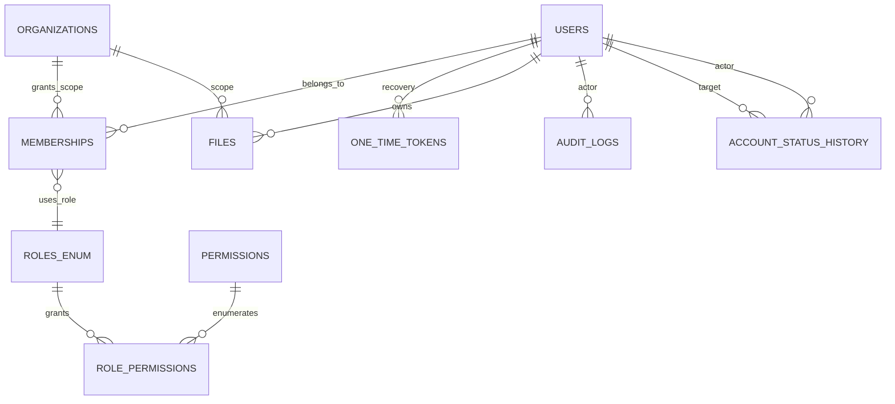

> Tài liệu baseline được giữ để truy vết thiết kế ban đầu. Code và kết quả kiểm thử sau triển khai ngày 29/10/2026 xem [DATABASE.md](DATABASE.md) và [báo cáo thực thi](TEST_REPORT.md); các câu “chưa triển khai/chưa test” bên dưới mô tả baseline, không phải trạng thái mới nhất.

# Công việc 3 – Database Core / MySQL / Flyway

## 1. Schema migration và ranh giới

- `V1__foundation.sql`: giữ nguyên users, organizations, memberships, one_time_tokens, audit_logs.
- `V2__spring_sessions.sql`: giữ nguyên SPRING_SESSION và SPRING_SESSION_ATTRIBUTES.
- `V3__permissions_and_membership_integrity.sql`: permissions, role_permissions, unique membership scope_key.
- `V4__audit_expansion.sql`: audit request_id, org_id, reason_code, source, index.
- `V5__files_metadata.sql`: metadata file, classification, antivirus status.
- `V6__membership_status_audit.sql`: updated_at membership + account_status_history.

**Không chỉnh sửa V1/V2 trên DB đã migrate.** Chạy `mvn flyway:...` không bắt buộc do Spring Boot Flyway khởi động cùng app. `ddl-auto: validate` chỉ so sánh JPA mapping với schema, không tự tạo bảng. Dùng MySQL 8.4 và charset utf8mb4.

## 2. ERD logic

`ROLES_ENUM` là danh mục role trong Java + chuỗi lưu DB (không phải bảng vật lý). Bảng member role thực tế liên kết tới `users`/`organizations` và dùng role code ổn định. `SPRING_SESSION` là session riêng và không nên tự FK tới users; phiên có thể hết hạn độc lập.

## 3. Từ điển dữ liệu cốt lõi

| Bảng | Khóa | Trường quan trọng | Điều kiện |
|---|---|---|---|
| `users` | `id` UUID varchar36 | email, password_hash, display_name, status, security_version, failed_attempts, locked_until, created_at, updated_at | email unique, pass hash only |
| `organizations` | `id` | name, type, status, created_at | status cơ bản; T5 giữ verification details |
| `memberships` | `id` | user_id, organization_id, role, active, scope_key generated, updated_at | `(user_id,role,scope_key)` unique; ADMIN global null org |
| `permissions` | code | resource, action, description | code unique; change through Flyway |
| `role_permissions` | (role,permission_code) | role, permission_code | referenced permission, role aligned Java enum |
| `one_time_tokens` | id | token_hash, purpose, user_id, email, org_id, expires_at, consumed_at | store hash, not raw token |
| `SPRING_SESSION` | primary_id | session_id, principal_name, expiry_time | Spring Session manages |
| `files` | id | owner_user_id, organization_id, storage_key, name, sha256, content_type, size_bytes, classification, scan_status | metadata only; no public object URL |
| `audit_logs` | id | actor_id, action, resource_type/id, result, organization_id, request_id, reason_code, created_at | append-only concept |
| `account_status_history` | id | user_id, actor_id, from_status, to_status, reason_code, changed_at | actor/target provenance |

## 4. Quy ước quan trọng

- Mọi `*_id` dùng UUID dạng `VARCHAR(36)` như Authentication đã có; thống nhất thời gian UTC, `DATETIME(6)`.
- T1 cấp ID ổn định và API identity; team khác dùng FK logic/physical theo quyết định chung.
- `nullable` có ý nghĩa: global ADMIN membership với `organization_id = NULL`, không có nghĩa user thuộc mọi tổ chức.
- `scope_key` generated `COALESCE(organization_id,'GLOBAL')` giải quyết MySQL UNIQUE + NULL, bảo vệ hai membership global ADMIN trùng nhau.
- `users.security_version` tăng mỗi lần thay đổi trạng thái/quyền/mật khẩu/thu hồi phiên để bảo vệ session đã được cấp.
- Không thêm column sinh viên, CV, ngành học vào `users`; thuộc T2.
- Không thêm dữ liệu xác thực doanh nghiệp, yêu cầu hợp tác vào `organizations`; thuộc T5.
- `files` chỉ đăng ký metadata, quyền truy cập tệp phải qua nghiệp vụ tham chiếu, kiểm tra nội dung + trạng thái scan; **chưa có upload/download production**.
- FK trong `audit_logs.actor_id` khiến không xóa cứng user dễ dàng; cần quyết định chính sách retention/xóa hoặc ẩn danh có kiểm soát.

## 5. Quy tắc transaction, migration và index

- Dùng `@Transactional` với status/role management, cùng transaction với audit thành công để tránh trạng thái đổi mà không có log.
- Trường hợp deny được ghi qua `REQUIRES_NEW`, tránh mất log khi nghiệp vụ rollback.
- T1 giữ độc quyền migration bảng core, teams gửi PR thay đổi có review.
- Dùng `ddl-auto=validate`, cấm `create`, `update`, `create-drop` trên DB dùng chung.
- Index đang có: membership lookups, audit action/actor/org + time, file owner/org + time.
- Backup và thử restore, quan trắc slow query, kiểm tra locking/concurrency của last-admin là **production gate**.

## 6. Các tích hợp cần thêm khi phát triển tiếp

T2: `student_profiles.user_id -> users.id`; chứng chỉ, minh chứng có `files.id`.  
T3: `tasks.placement_id` do T5 sinh ra; báo cáo có `files.id`; audit dùng actor_id.  
T4: `skill_catalog` và matching result của T4; chỉ tham chiếu `user_id`, không sở hữu identity.  
T5: enterprise verification entity tham chiếu `organizations.id`, demands và Placement thuộc T5; chia sẻ hồ sơ là nguồn cho `ProfileVisibilityPort`.
