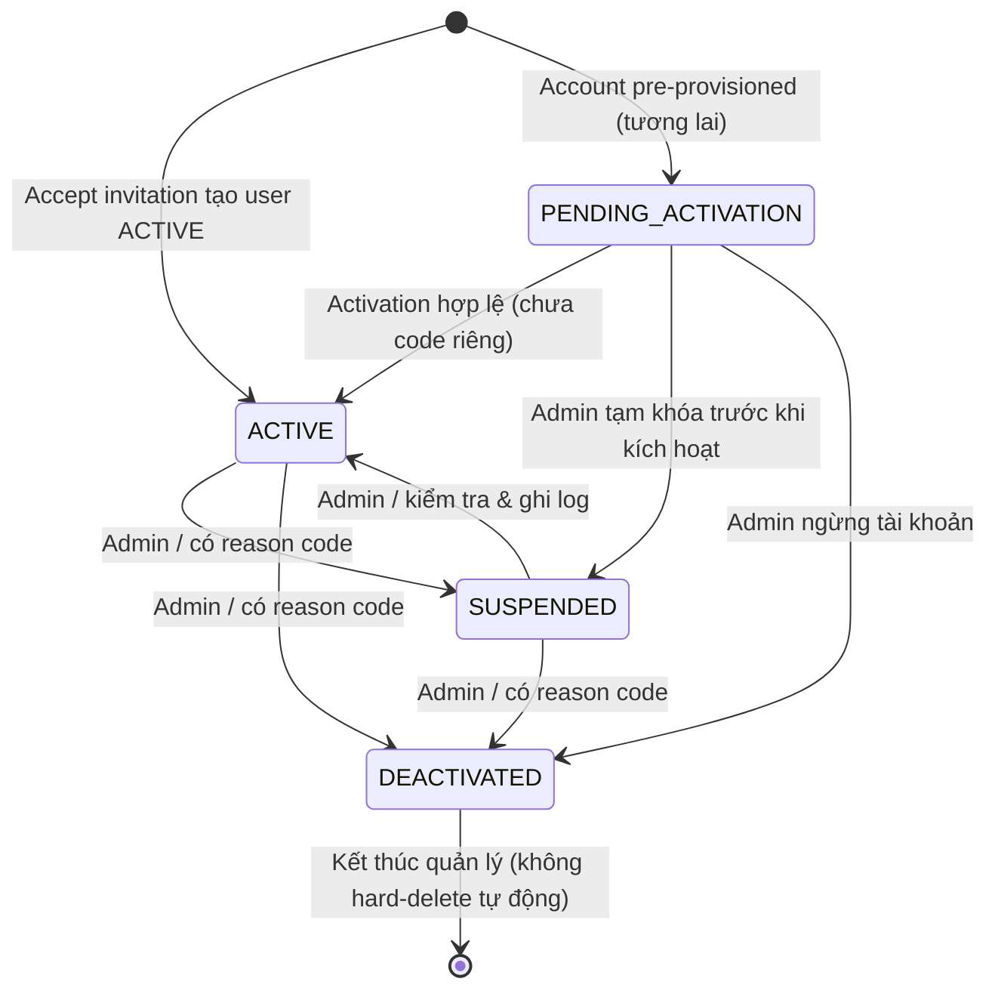

> Tài liệu baseline được giữ để truy vết thiết kế ban đầu. Code và kết quả kiểm thử sau triển khai ngày 29/10/2026 xem [ACCOUNT_LIFECYCLE.md](ACCOUNT_LIFECYCLE.md) và [báo cáo thực thi](TEST_REPORT.md); các câu “chưa triển khai/chưa test” bên dưới mô tả baseline, không phải trạng thái mới nhất.

# Công việc 4 – Sơ đồ trạng thái tài khoản & quy tắc chuyển

## 1. Phân biệt 4 vòng đời

- **Account lifecycle** (`users.status`): tài khoản có thể xác thực hay không.
- **Temporary credential lock** (`users.locked_until`): bảo vệ tấn công mật khẩu, không phải `SUSPENDED`.
- **Organization verification** (`organizations.status` và dữ liệu xác thực T5): tổ chức đã được phép sử dụng chức năng doanh nghiệp hay chưa.
- **Role membership** (`memberships.active`): cá nhân có quyền đại diện tổ chức trong vai trò nào; một người có nhiều membership.

Không biến khóa tài khoản thành cơ chế từ chối/duyệt doanh nghiệp của T5. Không biến active membership thành bảo chứng rằng student placement đã hợp lệ.

## 2. Trạng thái tài khoản đề xuất và code enum hiện có

`PENDING_ACTIVATION` → chờ link mời/kích hoạt hợp lệ.  
`ACTIVE` → được xác thực nếu mật khẩu đúng, không đang temporary locked.  
`SUSPENDED` → tạm ngừng truy cập, admin có quyền mở lại.  
`DEACTIVATED` → vô hiệu hóa dài hạn, **không có API mở lại tự động** trong starter. Muốn khôi phục cần thiết kế và phê duyệt quy trình riêng.

**Lưu ý:** Trong code Authentication #1, `AccountTokenService.acceptInvitation` **tạo tài khoản ACTIVE mới** khi chấp nhận lời mời, không tạo tài khoản PENDING trước đó. `PENDING_ACTIVATION` là trạng thái dự phòng cho luồng import/pre-provision tương lai; nếu dùng phải xây activation riêng. PENDING→ACTIVE không qua API admin status. Chuyển trạng thái không hỗ trợ mặc định thì trả lỗi. Việc mất truy cập do `locked_until` là độc lập; sau 15 phút hoặc reset/đổi theo chính sách mới cho phép.

## 3. Bảng chuyển trạng thái: ai – điều kiện – hiệu ứng

| Từ → Đến | Actor | Điều kiện | Hiệu ứng |
|---|---|---|---|
| Không có user → ACTIVE | User có token invite | Token đúng/hạn, email unique, mật khẩu hợp lệ | tạo user ACTIVE + membership, consume token, audit |
| PENDING → SUSPENDED | Global ADMIN | reason code, không tự khóa | status, security_version++, history, audit |
| PENDING → DEACTIVATED | Global ADMIN | reason code | tương tự |
| ACTIVE → SUSPENDED | Global ADMIN | reason code, không disable admin cuối | revoke sessions qua version, history, audit |
| SUSPENDED → ACTIVE | Global ADMIN | reason code; kiểm tra an toàn | re-enable auth, audit |
| ACTIVE → DEACTIVATED | Global ADMIN | reason code, không admin cuối | revoke sessions, history, audit |
| SUSPENDED → DEACTIVATED | Global ADMIN | reason code | history, audit |
| DEACTIVATED → ACTIVE | Không hỗ trợ | cần phê duyệt recovery workflow mới | deny |
| Bất kỳ → cùng trạng thái | Global ADMIN | idempotent | no-op, không tạo sự kiện giả |

`reason_code` là mã có kiểm soát (VD `SECURITY_INCIDENT`, `PROGRAM_COMPLETED`, `MANUAL_REVIEW`); **không chứa mô tả cá nhân nhạy cảm**.

## 4. Quy trình khóa tài khoản

1. Admin login; API `PATCH /api/v1/admin/users/{id}/status` có CSRF, `account:admin:status`.
2. `AccountLifecycleService` lock user row `findByIdForUpdate`, kiểm tra trạng thái đích và bảo vệ admin cuối.
3. Set status, reset failed_attempts/locked_until, tăng security_version.
4. Tạo `account_status_history` + audit trong transaction.
5. Session người bị khóa có thể vẫn còn record JDBC, nhưng request sau bị `AccountGuardFilter` từ chối rồi invalidated.
6. UI cần chuyển về màn hình login, không hiển thị nội dung cũ. Đồng bộ nhiều tab bằng trạng thái phiên hoặc phản hồi 401.

## 5. Thu hồi phiên không thay status

`PATCH /api/v1/admin/users/{id}/revoke-sessions` tăng security_version và ghi audit; `ACTIVE` vẫn ACTIVE, cần đăng nhập lại. Áp dụng khi nghi ngờ lộ cookie, đổi mật khẩu, membership thay đổi, người dùng mất thiết bị.

## 6. Bảo vệ admin cuối cùng

Starter ngăn admin tự disable mình và ngăn disable/revoke admin duy nhất còn ACTIVE bằng đếm membership active. **Chưa đạt bảo đảm chống race-condition tuyệt đối** nếu hai admin bị disable đồng thời: production phải serial hóa thao tác qua lock quản trị hoặc thiết kế invariant tại DB, và test concurrency 2 transaction.

## 7. User Story & acceptance

- US-T1-STA-01: Admin khóa account ACTIVE → 200, status SUSPENDED, phiên cũ request tiếp theo 401, audit+history.
- US-T1-STA-02: Admin mở khóa SUSPENDED → 200, ACTIVE; cần login lại, không khôi phục session cũ.
- US-T1-STA-03: Admin không được vô hiệu hóa chính mình/để hệ thống không còn admin → 400/409 (chuẩn lỗi còn thống nhất với API error handler).
- US-T1-STA-04: Pending account chưa có token hợp lệ không được phép ACTIVE chỉ bằng sửa status.
- US-T1-STA-05: DEACTIVATED không có luồng kích hoạt lại tự động.
- US-T1-STA-06: Thu hồi phiên không thay trạng thái account.
- US-T1-STA-07: Tạm khóa do 5 lần sai mật khẩu không biến `status` thành SUSPENDED và không cấp thêm quyền.

## 8. Thiết kế UI

Wireframe admin: danh sách tài khoản (email/masked ID, role(s), status, lock-until), bộ lọc, mở chi tiết, nút SUSPEND/REACTIVATE/DEACTIVATE/REVOKE SESSIONS theo quyền, modal nhập reason code, trang lịch sử biến động. Frontend không được chuyển trạng thái trái policy chỉ bằng việc gửi JSON thủ công.
