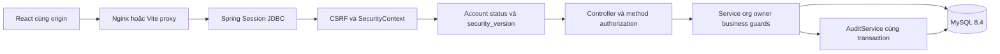

# Kiến trúc Core Platform

UT.Bridora T1 tiếp tục source hiện có, Java21, Spring Boot4.1.2, Spring Security7.1.2, Maven, MySQL8.4, Spring Session JDBC và Flyway. Giữ modular monolith. React19 + TypeScript dùng Vite; đã có dashboard shell, quản trị tài khoản/membership, audit và recovery.

## Ranh giới module

| Package | Trách nhiệm |
|---|---|
| api | HTTP DTO/controller, validation và lỗi an toàn |
| security | AuthenticationManager/DaoAuthenticationProvider, principal, session/CSRF strategy, account guard |
| authorization | Permission catalog, global/org guards, membership service, administration mutex, profile port |
| core | Credential và account lifecycle transaction |
| user / organization | Identity, membership và trạng thái cốt lõi |
| tokens | Invitation/reset token hash, expiry và atomic consume |
| audit | Registry, writer/view, correlation ID |
| files | Metadata; chưa triển khai storage/upload/download |
| bootstrap | Khởi tạo admin tùy chọn từ env trong một transaction |
| web-demo/src | API client, component dùng chung, auth/account/admin/audit UI |

Không có package common riêng chỉ để gom tiện ích; DTO và component hiện được tái sử dụng từ nơi sở hữu. T2–T5 thêm module business, không nhân đôi identity hay session.

## Luồng bảo vệ

Login JSON dùng AuthenticationManager và CompositeSessionAuthenticationStrategy gồm ChangeSessionIdAuthenticationStrategy + CsrfAuthenticationStrategy; lưu SecurityContext tường minh. AppPrincipal serialize được, password hash là transient và không có trong JDBC session. Cookie HttpOnly, SameSite=Lax, Secure ở HTTPS; client không lưu session vào localStorage.

Xác thực thành công, đổi/reset mật khẩu và mutation quyền/trạng thái khóa user phù hợp. Version cũ bị chặn trên request tiếp theo. Backend kiểm tra account lại trong policy, không chỉ dựa vào role có trong session. Admin mutation được serial hóa qua row GLOBAL_ADMIN và recheck actor sau lock.

## Transaction và tích hợp

Credential, status/history và membership có audit SUCCESS cùng transaction. Denial dùng REQUIRES_NEW, không ghi URL/body. Token reset dùng conditional UPDATE để chống replay đồng thời dưới REPEATABLE_READ. V1–V6 giữ nguyên; V7 chỉ thêm lock/index.

ProfileVisibilityPort mặc định deny. Boolean port là cổng truy cập tổng quát; T2/T5 còn phải kiểm tra và lọc field/purpose/time/consent. T3 giữ assignment/Placement; T4 giữ anonymity. Bảng role-permission không tự cấp ADMIN quyền business.

SecurityConfig mặc định deny những path chưa đăng ký. Team tích hợp phải khai báo authenticated path cụ thể và thêm guard nghiệp vụ. Chưa có tự động discover permission theo controller.

## Vận hành và giới hạn

Actuator chỉ mở health, không lộ chi tiết. Readiness gồm database; SMTP được giám sát riêng, không làm identity health DOWN. Nginx staging phục vụ SPA/API cùng origin và security headers. Không public cổng backend/database trong staging Compose.

Chưa có durable email outbox/retry, gateway IP throttling, MFA, WORM, retention được ký hoặc business adapter thật. API Page giữ hình dạng Spring Data kế thừa; client dùng content/number/size/totalElements/totalPages, chưa bảo đảm mọi metadata phụ giữa các lần nâng framework. Không tuyên bố production-ready.

Tham khảo cơ chế [Spring Security session persistence](https://docs.spring.io/spring-security/reference/servlet/authentication/session-management.html): custom authentication phải gọi session strategy và lưu context. Phiên bản framework của project đã được Maven resolve và build thực tế; không đổi framework hàng loạt.
