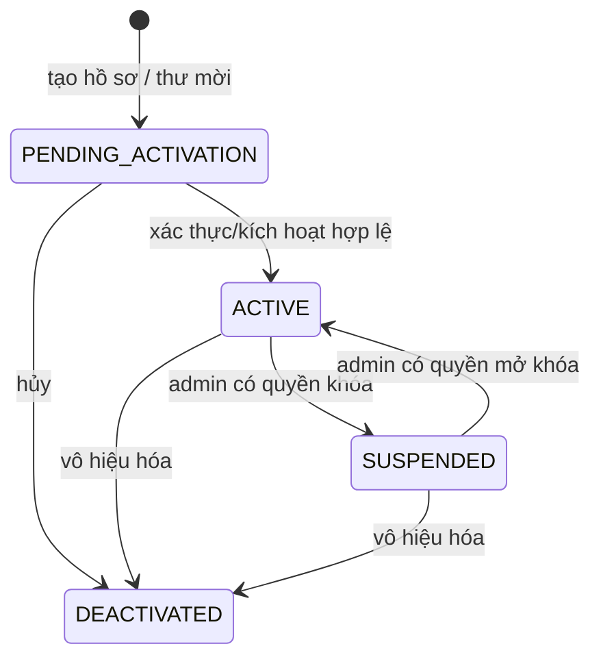
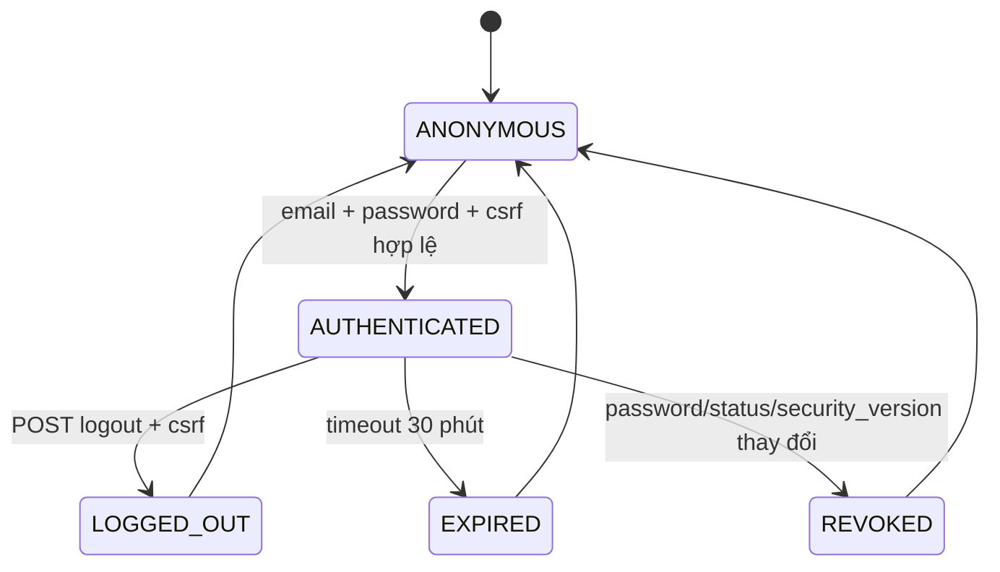
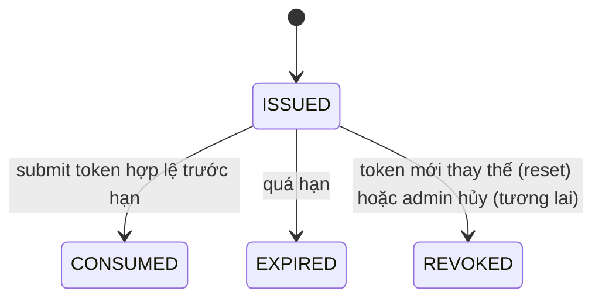
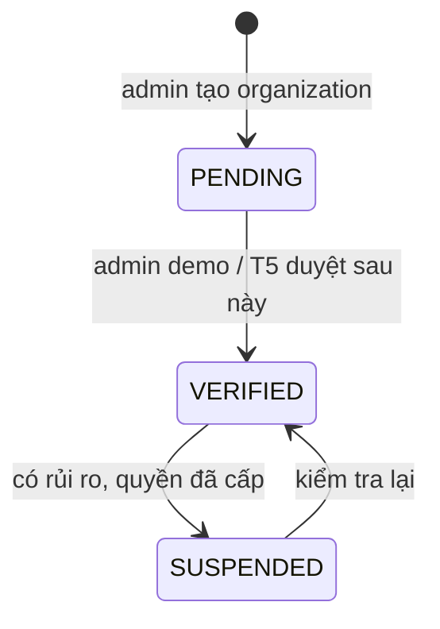

> Tài liệu baseline được giữ để truy vết thiết kế ban đầu. Code và kết quả kiểm thử sau triển khai ngày 29/10/2026 xem [ACCOUNT_LIFECYCLE.md](ACCOUNT_LIFECYCLE.md) và [báo cáo thực thi](TEST_REPORT.md); các câu “chưa triển khai/chưa test” bên dưới mô tả baseline, không phải trạng thái mới nhất.

> ⚠️ **TÀI LIỆU AUTHENTICATION GỐC (#1):** xem `00_TONG_QUAN_T1_02_05.md` và `05_API_HANDOFF.md` để biết API #2–#5 đã cập nhật. Endpoint xác thực tổ chức chỉ còn demo-only dưới `/api/v1/demo/admin/...`.

# Sơ đồ trạng thái – Team 1

## 1. Account (đề xuất; trạng thái PENDING chưa có flow tạo user riêng ở starter)

## 2. Session

## 3. One-time invitations / reset

## 4. Organization demo

**Ghi chú:** Sơ đồ state mô tả cả mục tiêu thiết kế; starter chưa triển khai tất cả transition như tạo PENDING, DEACTIVATED -> ACTIVE, quản lý thiết bị; riêng xác thực doanh nghiệp thực tế phải do T5 thiết kế.
