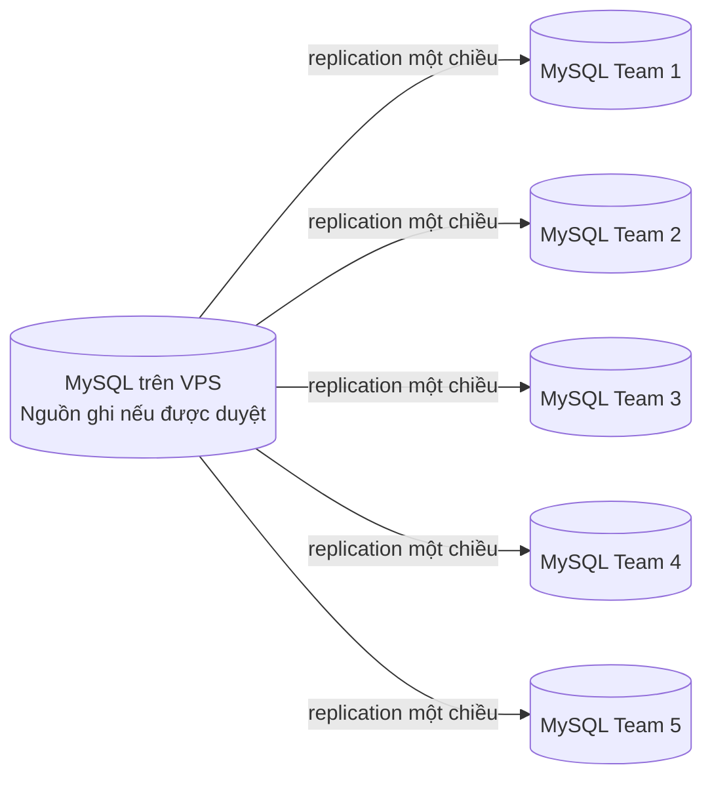

# Đồng bộ dữ liệu Docker giữa các team

Cập nhật: 31/10/2026. Phạm vi đã xác nhận: mỗi team giữ MySQL Docker riêng và nhóm đã có VPS.
**Trạng thái: khảo sát thiết kế; chưa cấu hình replication, chưa kết nối VPS và chưa thay đổi dữ liệu.**
Tài liệu không chuyển lựa chọn này thành một database dùng chung và không coi VPS là nơi ghi duy nhất đã được duyệt.

## 1. Những quyết định còn cần chốt

| Quyết định | Thông tin cần có |
|---|---|
| Chiều ghi | Chỉ VPS ghi và gửi xuống; mọi team đều ghi; hay làm mới bản sao theo lịch? |
| Phạm vi dữ liệu | Toàn bộ database hay chỉ bảng/dữ liệu demo nào; team nào sở hữu từng loại bản ghi? |
| Dữ liệu ban đầu | Lấy bản nào làm baseline; dữ liệu riêng nào của từng team phải được giữ và hợp nhất? |
| VPS và mạng | Hệ điều hành, phiên bản MySQL/Docker, khả năng SSH, VPN/private IP và kết nối từ các máy team. |
| Mức đồng bộ | Độ trễ chấp nhận được, yêu cầu khi mất mạng và ai giải quyết xung đột. |

Không gửi mật khẩu, private key hoặc token qua tài liệu/chat công khai; thông tin truy cập được cấu hình qua kênh riêng.

## 2. Hai mô hình cần phân biệt

### Một chiều — chỉ là phương án để lựa chọn

- Các team có bản sao riêng; thay đổi ở nguồn được truyền xuống, có thể có độ trễ.
- Bản sao chỉ đọc phù hợp cho truy vấn/đối soát đã được cho phép, không tự nhận thay đổi do team ghi ngược lên.
- Phải chốt nguồn ghi và quy trình làm mới; sơ đồ này chưa phải cấu hình đã triển khai.

### Nhiều chiều — nếu mọi team đều phải ghi tại máy mình

- Cần thiết kế riêng đường truyền thay đổi Team ↔ VPS ↔ các team, quyền sở hữu và xử lý xung đột.
- Cần quy tắc cho sửa cùng bản ghi, tạo trùng email/membership, xóa bản ghi và cập nhật khi offline.
- Không tự áp dụng “bản mới nhất thắng” cho mật khẩu, quyền, trạng thái tài khoản hoặc audit.
- MySQL multi-source nhận giao dịch từ nhiều nguồn nhưng không tự phát hiện/giải quyết xung đột ứng dụng. [Tài liệu MySQL 8.4](https://dev.mysql.com/doc/refman/8.4/en/replication-multi-source.html)
- Group Replication multi-primary có giới hạn với DDL/DML đồng thời và khóa `SELECT ... FOR UPDATE` không được chia sẻ giữa các member; cần kiểm chứng schema và nghiệp vụ trước khi chọn. [Giới hạn Group Replication](https://dev.mysql.com/doc/refman/8.4/en/group-replication-limitations.html)

Chưa lựa chọn công nghệ/chiến lược nhiều chiều và chưa bổ sung thành phần đồng bộ thay đổi.

## 3. Những ràng buộc đã xác nhận từ source

| Thành phần | Hiện trạng và hệ quả với đồng bộ |
|---|---|
| Kết nối database | Backend dùng một `spring.datasource`; chưa có routing nguồn ghi/bản sao đọc. |
| Authentication | Đăng nhập ghi bộ đếm, khóa tạm và audit; đổi/reset mật khẩu ghi user/token/version. |
| Session | Spring Session JDBC ghi `SPRING_SESSION` và `SPRING_SESSION_ATTRIBUTES`; CSRF dựa trên session. |
| Audit | Mutation và audit SUCCESS cùng transaction; không tự bỏ audit để chạy trên bản sao chỉ đọc. |
| Khóa quản trị | `core_locks` + `SELECT ... FOR UPDATE` bảo vệ trong một MySQL, không thay thế distributed lock. |
| Flyway | Migration chạy khi backend khởi động; cần một đầu mối phát hành, cùng version/checksum trên các bên. |
| ID và unique | ID UUID giảm trùng ID nhưng không tránh trùng email hoặc `(user, role, scope)` độc lập giữa các DB. |
| Thời gian | UTC/Instant hiện có; timestamp không phải cơ chế phát hiện xung đột hay phiên bản đồng bộ. |

**Không thay database chạy backend hiện tại bằng replica chỉ đọc rồi coi ứng dụng đã hoạt động.**
Ngay các luồng authentication/session cũng cần ghi. Nếu chọn một chiều, phải thiết kế rõ nơi backend ghi và cách dùng bản sao đọc trước khi sửa cấu hình.
Nếu chọn nhiều chiều, cần chứng minh các bất biến bảo mật khi thu hồi quyền, tiêu thụ token một lần và bảo vệ admin cuối trên nhiều nơi ghi.
`AccountGuardFilter` đọc user/status/security_version từ database mà backend đang kết nối; replication lag có thể làm quyền/phiên cũ còn được chấp nhận ở máy khác.
Chưa bảo đảm thu hồi quyền hoặc đặt lại mật khẩu có hiệu lực đồng thời trên mọi bản sao; phải thiết kế và kiểm thử thời điểm có hiệu lực.
Các bảng session, token, audit và thông tin xác thực cần quyết định phạm vi riêng; chưa mặc định sao chép hoặc loại trừ bảng nào.

## 4. Bảo toàn dữ liệu hiện có trước khi khởi tạo

1. Lập danh sách MySQL, database, volume, phiên bản schema và dữ liệu demo đang có ở từng team/VPS.
2. Backup từng database, ghi nhận nguồn/thời điểm và thử restore vào database dùng một lần; giữ nguyên volume hiện hành.
3. Chọn baseline được nhóm thống nhất; không mặc định database của Team 1 hay VPS là bản đúng nhất.
4. Đối soát email, tổ chức và membership; lập bảng mapping ID nếu cùng đối tượng có UUID khác nhau.
5. Kiểm tra mọi tham chiếu user/organization/owner và lịch sử liên quan sau mapping; không ghép dump nối tiếp tùy tiện.
6. Thống nhất xử lý mật khẩu khác nhau, token, phiên cũ và audit; không nhập session/token từ nhiều DB một cách mặc định.
7. Thử baseline đã hợp nhất trên bản sao, xác minh FK/unique/permission trước khi lập kế hoạch chuyển đổi.

Chưa chạy import/restore lên database hiện hành; không xóa volume, reset database hoặc sửa migration đã áp dụng.
Replication truyền thay đổi không thay thế backup; cần bản backup có thể khôi phục độc lập.

## 5. Kết nối và vận hành

- Kết nối MySQL qua mạng riêng/VPN hoặc SSH tunnel phù hợp; cấu hình TLS khi truyền replication.
- Không mở MySQL trực tiếp ra Internet cho tất cả IP; giới hạn nguồn kết nối và tách tài khoản replication khỏi admin/runtime.
- Secret và chứng chỉ đặt ngoài Git; không sao chép `.env.local` của một thành viên thành cấu hình chung cho mọi máy.
- Chỉ bổ sung `server_id`/GTID/binlog/channel sau khi đã chốt topology và kiểm tra dữ liệu nền; tài liệu này chưa tạo cấu hình đó.
- Một người phụ trách migration: giữ nguyên migration đã chạy, cấp số phiên bản tập trung, kiểm tra thứ tự trước phát hành.
- Xác định giám sát độ trễ/lỗi, dừng đồng bộ có kiểm soát, quay lại bản sao an toàn và quy trình phục hồi khi mất mạng.
- Các team tiếp tục dùng Testcontainers/database dùng một lần cho test có cleanup; không trỏ các test này vào DB đang đồng bộ.

## 6. Kiểm thử bắt buộc trước khi dùng chung dữ liệu

| Kiểm thử dự kiến | Trạng thái |
|---|---|
| Backup từng bên và restore bản sao thành công | NOT RUN |
| Baseline/mapping bảo toàn user, organization, membership và FK/unique | NOT RUN |
| Kết nối private/VPN/SSH, TLS và quyền tài khoản tối thiểu | NOT RUN |
| Thêm/sửa/xóa dữ liệu demo truyền đúng hướng, đúng phạm vi | NOT RUN |
| Không có local write ngoài quy tắc nếu chọn mô hình một chiều | NOT RUN |
| Đăng nhập, CSRF, logout và JDBC session với topology đã chọn | NOT RUN |
| Reset token dùng một lần, đổi mật khẩu, thu hồi quyền/phiên và admin cuối | NOT RUN |
| Xung đột cùng bản ghi/unique và ghi offline nếu chọn nhiều chiều | NOT RUN |
| Flyway đúng version/checksum, không phát sinh DDL ngoài kế hoạch | NOT RUN |
| Mất mạng, bắt kịp lại dữ liệu, cảnh báo và phục hồi | NOT RUN |

Đây là danh sách cần thực thi sau khi chọn mô hình; không phải kết quả test đã PASS.
Tham khảo [triển khai](../guides/DEPLOYMENT_GUIDE.md), [database](../core/DATABASE.md), [authorization](../core/AUTHORIZATION.md) và [vòng đời tài khoản](../core/ACCOUNT_LIFECYCLE.md).
