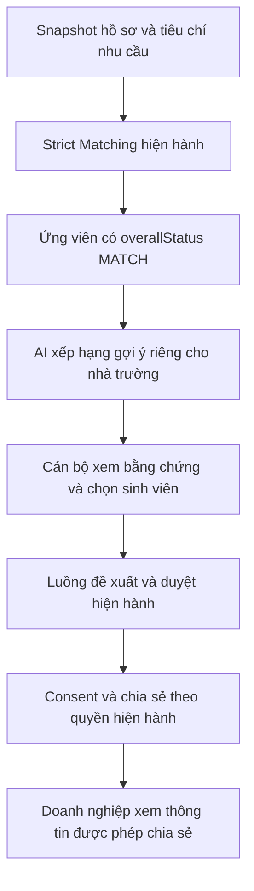

# Lộ trình AI đề xuất sinh viên cho nhà trường

Cập nhật ngày 21/11/2026 theo yêu cầu đưa AI vào việc hỗ trợ lựa chọn sinh viên. Mục tiêu cuối là một danh sách gợi ý có thứ tự do AI hỗ trợ, để cán bộ nhà trường xem xét trước khi đề xuất sinh viên. Điểm tương đồng chạy nền của lượt 1 là nền kỹ thuật; riêng phần đó chưa hoàn thành mục tiêu sản phẩm.

Lượt 2/giai đoạn 5 đã có [bộ đặc tả mở rộng cụ thể](../contracts/extensions/ai-advisory-v1/README.md). Theo yêu cầu tiếp theo, lượt 3 đã bổ sung [code backend/API/UI và recipe môi trường riêng](AI_MATCHING_ADVISORY.md). Tính năng vẫn OFF, chưa áp migration/deploy; kiểm chứng model thật/MySQL/full-stack và chất lượng còn ở giai đoạn 7–8.

## Luồng sử dụng đích

AI được phép thay đổi **thứ tự trong danh sách gợi ý mới của nhà trường**. `overallStatus`, `fitScore`, thứ tự và phân trang canonical, dữ liệu tổng hợp doanh nghiệp và các quyết định nghiệp vụ hiện hành vẫn tuân theo contract đã duyệt. Doanh nghiệp không được cấp danh sách hồ sơ từ endpoint matching chỉ vì AI đã chấm điểm.

Ví dụ minh họa chính sách, chưa phải kết quả model: A và B cùng `MATCH`; canonical đặt A trước B, trong khi danh sách AI có thể đặt B trước A nếu nội dung dự án phù hợp JD hơn. C có `NOT_MATCH` hoặc `MISSING_DATA` vẫn ở ngoài tập xếp hạng AI dù văn bản tương đồng cao. Cán bộ có thể chọn A theo quy trình hiện hành; AI không tự tạo đề xuất.

## Tám giai đoạn triển khai

Giữ số 1–4 của kế hoạch trước để truy vết phần đã làm. Phạm vi 5–8 dưới đây thay phần kế hoạch tiếp theo trước đó, bổ sung sản phẩm gợi ý AI thay vì dừng ở điểm tương đồng.

| Giai đoạn | Công việc và đầu ra | Điều kiện chuyển bước | Trạng thái ngày 21/11/2026 |
|---|---|---|---|
| 1. Bảo toàn workspace | Snapshot HEAD, nhánh, index, Plan/config/stash và hash tài liệu; worktree riêng | Có bằng chứng trước/sau, không đưa thay đổi riêng vào task | Đã thực hiện cho lượt 1 |
| 2. Đối chiếu yêu cầu và khảo sát | Xác định strict matching, owner ports, dữ liệu hiện có và giới hạn contract | Có sơ đồ luồng và phạm vi canonical-v1; không nhận nhầm là phân tích CV/JD đầy đủ | Đã thực hiện; cần bổ sung khảo sát cho nguồn văn bản mới ở bước 5 |
| 3. Dịch vụ AI tự host | FastAPI, E5 CPU/offline, pin revision/checksum, giới hạn tài nguyên và giao thức | Unit/protocol đạt; kiểm model thật tiếp tục ở bước 7 | Đã có code và kiểm thử nhẹ; model thật chưa chạy |
| 4. Tích hợp Java chạy nền | Typed client, snapshot bất biến, xử lý sau commit, hàng đợi giới hạn, mặc định OFF | ON/OFF giữ kết quả canonical; rollback/replay/enterprise không suy luận sai | Đã có code và kiểm thử unit/protocol; MySQL runtime chưa chạy |
| 5. Contract mở rộng và dữ liệu ngữ nghĩa | Đặc tả API/view gợi ý school-only, quyền/audit, policy/version; hợp đồng owner ports T2/T5, snapshot dự án/kỹ năng mô tả và JD; thiết kế lưu trữ/cache/job/TTL | Có đặc tả cụ thể để review: dữ liệu được phép, schema/error/status/paging, tie-break, thiếu dữ liệu, stale/revoke, retention và bộ đánh giá chất lượng. Phần vượt baseline được quyết định trong extension riêng | Đã hoàn thành bộ đặc tả lượt 2; SPEC_READY_FOR_REVIEW, chưa cài runtime |
| 6. Sản phẩm gợi ý AI | Triển khai ports, migration forward nếu cần, job bền vững/cache; xếp hạng toàn bộ tập MATCH; API/UI nhà trường, kiểm quyền hiện tại; Docker recipe cho môi trường riêng | Kiểm thử backend/UI chứng minh thứ tự gợi ý thực sự thay đổi; thiếu dữ liệu/lỗi có hành vi rõ; nút đề xuất đi qua guard nghiệp vụ hiện hành; có công tắc tắt riêng | Đã có code lượt 3 + kiểm DEV nhẹ/component; V44 chưa áp, MySQL/full-stack/model thật chưa kiểm |
| 7. Kiểm chứng kỹ thuật và chất lượng | Model E5 thật/offline, MySQL/ClamAV và browser thật theo phạm vi; full regression/contract/build; so sánh ranking với baseline trên bộ nhãn đã chốt; benchmark môi trường riêng | Báo cáo đúng manifest/commit, đủ kết quả và giới hạn; đạt tiêu chí chất lượng, quyền và tài nguyên đã chốt trước đo | Chưa chạy; bằng chứng fake encoder không thay thế bước này |
| 8. Thử nghiệm sử dụng và bàn giao | Pilot phạm vi trường được cho phép; cán bộ so sánh danh sách, ghi nhận lựa chọn/feedback; rollback, vận hành, retention và bàn giao | Có quyết định nghiệm thu/bật theo phạm vi phù hợp; nếu chất lượng chưa đạt thì giữ OFF hoặc tiếp tục shadow | Chưa thực hiện |

Giai đoạn 6 có thể dùng model giả trong unit để kiểm logic giao thức và thứ tự. Chỉ kết quả model thật ở giai đoạn 7 mới làm căn cứ đánh giá chất lượng đề xuất. Mô hình/cấu hình được thay đổi sau đánh giá phải chạy lại các kiểm tra bị ảnh hưởng.

## Chia thành bốn lượt làm việc

| Lượt | Giai đoạn | Kết quả cần chốt |
|---|---|---|
| 1. Nền kỹ thuật | 1–4 | Phần code hiện có và báo cáo giới hạn. Không làm lại từ đầu |
| 2. Đặc tả mở rộng | 5 | Đã có contract/policy/owner ports, schema/examples, tiêu chí đánh giá và ma trận bàn giao; chưa bật AI cho người dùng |
| 3. Tính năng gợi ý | 6 | Một luồng backend → API → UI → cán bộ đề xuất chạy được trong môi trường riêng, vẫn mặc định OFF |
| 4. Kiểm chứng và pilot | 7–8 | Bằng chứng model thật/chất lượng/full regression, rồi pilot và bàn giao theo kết quả đạt được |

Lượt 2 và lượt 3 được tách vì nguồn dữ liệu, quyền và chính sách ranking mới quyết định cách triển khai. Người dùng sau đó đã yêu cầu triển khai lượt 3; phần code được thực hiện theo quyết định riêng. Lượt 4 là bước tiếp theo để kiểm model thật, MySQL/full-stack/chất lượng và pilot theo môi trường/phạm vi được giao, không tự bật demo.

## Chính sách xếp hạng đã đặc tả ở giai đoạn 5

- **Tập ứng viên:** lấy toàn bộ `MATCH` của một run/snapshot nhất quán. Không dùng semantic top-K để cắt tập trước strict matching; không sắp lại riêng từng trang canonical rồi coi là ranking toàn cục. Quá giới hạn thì công bố trạng thái chưa sẵn sàng thay vì trả một tập thiếu dưới nhãn hoàn tất.
- **Thứ tự gợi ý:** policy semantic-desc-canonical-tie-v1 dùng cosine làm tròn HALF_UP sáu chữ số giảm dần, hòa điểm theo fitScore canonical rồi student UUID. Chưa cộng `fitScore` với cosine theo tỉ lệ 70/30; hai thang điểm không tự tương đương. Policy còn phải qua đánh giá chất lượng trước sử dụng.
- **Thiếu dữ liệu:** không đổi null/lỗi thành điểm 0 hoặc gắn nhãn kém phù hợp. Nhóm chưa có nội dung/quá lớn đứng sau nhóm có điểm, theo thứ tự canonical với rank/score null; vẫn đủ ứng viên và thống kê coverage. UI có đường xem toàn bộ ứng viên canonical, tránh giấu hồ sơ ít dữ liệu.
- **Tính nhất quán:** score/rank gắn run, profile snapshot, criteria/JD snapshot, taxonomy, template, model revision và policy version. Snapshot ranking hoàn tất phải ổn định xuyên các trang; không trộn một số batch thành công vào danh sách READY.
- **Quyền và thời hạn:** kiểm quyền trường/kỳ/nhu cầu ở mỗi lần đọc; định nghĩa vô hiệu hóa khi dữ liệu, phạm vi quyền hoặc trạng thái nghiệp vụ thay đổi. Dữ liệu hết hiệu lực không tiếp tục được gợi ý/đề xuất từ cache cũ.
- **Giải thích:** chỉ trình bày nội dung nguồn được phép và mối liên hệ đã tính, kèm nguồn tự khai/xác minh. E5 cosine không tạo được lời giải thích ngôn ngữ tự nhiên có kiểm chứng; không bịa lý do, suy ra kỹ năng mới hoặc gắn nhãn xác suất trúng tuyển.

## Dữ liệu và tiêu chí hoàn thành

Canonical-v1 hiện có chủ yếu là mã ngành/kỹ năng và lịch khả dụng. Để đánh giá lợi ích ngữ nghĩa, cần nội dung nghiệp vụ được phép: mô tả dự án/kinh nghiệm/kỹ năng của sinh viên và mô tả nhiệm vụ/JD của nhu cầu. Chủ sở hữu T2/T5 cung cấp qua port và snapshot có version; T4 không tự join bảng ngoài module. Trích xuất CV/file là phạm vi bổ sung nếu thực sự cần, phải tuân luồng truy cập và quét file hiện hành.

Trước khi tinh chỉnh policy, chốt tập nhu cầu/ứng viên có nhãn đánh giá phù hợp do người hiểu nghiệp vụ cung cấp, cách tách tập hiệu chỉnh và tập kiểm tra, baseline canonical, k theo nhu cầu sử dụng, metric như NDCG@k/Precision@k, coverage và thời gian cán bộ lựa chọn. So sánh cùng tập MATCH, nêu cỡ mẫu và độ bất định; kiểm sai lệch theo mức đầy đủ/ngôn ngữ hồ sơ nếu dữ liệu cho phép. Ngưỡng đạt cụ thể phải được chốt trước lần đo quyết định, không đặt sau để hợp thức hóa kết quả.

Tính năng hoàn thành mục tiêu hỗ trợ đề xuất khi có cả danh sách AI dùng được, quyết định của cán bộ đi qua quy trình hiện hành, bằng chứng chất lượng so với baseline và quyết định sử dụng theo phạm vi phù hợp. Chỉ có endpoint trả `semanticScore` chưa đủ.

## Giới hạn môi trường và tài liệu liên quan

Cập nhật lượt 4 ngày 23/11/2026: người dùng chưa có VPS, dự định thuê riêng 8 vCPU/16 GB/160 GB NVMe. Đã chuẩn bị source pack có hash, Linux/daemon preflight, full-regression runner, real-model offline/HTTP microbenchmark và metric evaluator; xem [hướng dẫn lượt 4](AI_MATCHING_ADVISORY.md). Giai đoạn 7–8 vẫn chưa hoàn tất: MySQL/model thật, actual advisory end-to-end, OS egress proof, nhãn/quality/load và pilot cần môi trường/dữ liệu tương ứng. Chưa deploy hoặc bật demo.

Giữ nguyên giới hạn Git, Docker và dữ liệu dùng chung: không tự commit/push/merge/PR/deploy, không rebuild/restart hoặc test container trên daemon phục vụ demo 8088; không đổi DB dùng chung, Plan/config/stash và bytes SRS/Contract đã duyệt. Đóng gói Docker ở bước 6 là chuẩn bị recipe; chạy thực tế thuộc môi trường tách biệt đã xác minh.

- [Prompt triển khai cập nhật](AI_MATCHING_PROMPT.md)
- [Kiến trúc và phạm vi hiện có](AI_MATCHING_ARCHITECTURE.md)
- [Chi tiết code lượt 1](AI_MATCHING_IMPLEMENTATION.md)
- [Báo cáo kiểm thử lượt 1](AI_MATCHING_TEST_REPORT.md)
