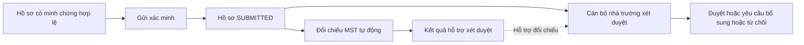

# Đặc tả bổ sung xác minh mã số thuế và tải minh chứng

| Thuộc tính | Nội dung |
|---|---|
| Dự án | UTBridora |
| Ngày ghi nhận | 28/11/2026 |
| Phiên bản | 0.1 |
| Phụ trách | Team 5 — DEV11 và DEV12 |
| Trạng thái | Bản bổ sung theo phần đã triển khai, chờ Leader/QA rà soát |
| Phạm vi | Tra cứu MST, đối chiếu tự động sau khi gửi hồ sơ, tải minh chứng và giao diện kéo thả tệp |

## Mục đích và cơ sở yêu cầu

Hệ thống hỗ trợ doanh nghiệp chuẩn bị hồ sơ xác minh theo trường, tra cứu thông tin doanh nghiệp, đính kèm tài liệu an toàn và gửi hồ sơ để nhà trường xét duyệt. Sau khi gửi, hệ thống tự động đối chiếu MST, tên và địa chỉ; cán bộ nhà trường sử dụng kết quả này để hỗ trợ quyết định.

[SRS tổng thể v1.2.4](UTBridora_SRS_Tong_The_v1.2.4.docx) quy định: “Doanh nghiệp nộp BM-03 và minh chứng; nhà trường xác thực theo từng school_org.” Bản bổ sung này chi tiết hóa phần phát triển ngày 28/11/2026; không thay thế SRS tổng thể hoặc tự thay đổi [Contract v1.1](../contracts/UTBridora_Contract_Pack_B01_B06_v1.1_Candidate.md).

Các mã yêu cầu trong tài liệu dùng để truy vết bản bổ sung, không phải mã task mới trong Plan. Kết quả tra cứu MST không tự cấp quyền, kích hoạt tài khoản hoặc phê duyệt hồ sơ.

## Tác nhân và trách nhiệm

| Tác nhân | Trách nhiệm |
|---|---|
| Đại diện doanh nghiệp | Nhập thông tin, tra cứu MST, lưu hồ sơ, tải và gỡ minh chứng, gửi xác minh theo từng trường |
| Cán bộ nhà trường được cấp quyền | Xem hồ sơ đã gửi trong phạm vi được cấp, xem đối chiếu MST, yêu cầu bổ sung, phê duyệt hoặc từ chối |
| Dịch vụ tra cứu MST | Cung cấp thông tin tra cứu và tình trạng doanh nghiệp; có thể không tìm thấy hoặc tạm thời không sẵn sàng |
| Dịch vụ tệp T1 | Lưu tệp riêng tư, kiểm tra quyền và binding, quét an toàn, phục vụ tải xuống theo quyền |
| Bộ xử lý đối chiếu nền | Xử lý các lần gửi hồ sơ đã lưu, ghi kết quả và thử lại khi nguồn tra cứu gián đoạn |
| Người dùng T2 và T3 | Dùng cùng giao diện kéo thả tại các form tải tệp sẵn có, theo quyền và quy trình của từng module |

DEV11 phụ trách xử lý nghiệp vụ và tích hợp backend T5. DEV12 phụ trách giao diện, tích hợp API và phản hồi trạng thái. Lưu trữ/quét tệp vẫn thuộc T1; chức năng nhập sinh viên, báo cáo, đánh giá và hồ sơ năng lực giữ chủ sở hữu hiện tại.

## Phạm vi chức năng

| Mã | Yêu cầu |
|---|---|
| FR-TAX-01 | Nhận diện cấu trúc MST và kiểm checksum theo bộ kiểm tra hiện có ở FE và BE |
| FR-TAX-02 | Tra cứu MST, hiển thị nguồn và kết quả, hỗ trợ điền tên/địa chỉ |
| FR-TAX-03 | Tự tạo công việc đối chiếu cho từng lần gửi hồ sơ thành công |
| FR-TAX-04 | Hiển thị kết quả đối chiếu tại màn nhà trường, cập nhật khi đang xử lý và cho phép yêu cầu kiểm tra lại |
| FR-VER-01 | Nhận diện hồ sơ đã tồn tại theo cặp doanh nghiệp–trường, hướng người dùng mở hồ sơ hiện có |
| FR-FILE-01 | Tải minh chứng xác minh vào đúng hồ sơ, chờ kết quả quét và chỉ lưu tham chiếu hợp lệ |
| FR-FILE-02 | Tải xuống hoặc gỡ tham chiếu minh chứng theo quyền và trạng thái hồ sơ |
| FR-UPLOAD-01 | Hỗ trợ chọn tệp bằng chuột, bàn phím và kéo thả tại sáu component đang có upload |
| FR-UPLOAD-02 | Hiển thị tệp và trạng thái thật, xử lý lỗi, giữ các giới hạn riêng của từng form |
| FR-UI-01 | Dùng màu Teal, chữ đủ rõ, bố cục không tràn màn hình và hỗ trợ giảm chuyển động |

Không bổ sung tự động duyệt doanh nghiệp, OCR giấy phép, tải nhiều tệp cùng lúc, kéo thả thư mục hoặc chức năng nghiệp vụ mới cho T2/T3.

## Luồng tra cứu MST của doanh nghiệp

**Tiền điều kiện:** người dùng có phiên hợp lệ và quyền `enterprise_verification:enterprise:manage` trong tổ chức đang làm việc.

1. Doanh nghiệp mở form tạo hoặc bổ sung hồ sơ, nhập mã đăng ký doanh nghiệp.
2. Hệ thống chuẩn hóa mã để kiểm tra: bỏ khoảng trắng, chuẩn hóa dấu gạch nối; chuỗi 13 số được biểu diễn thành 10 số và 3 số đơn vị phụ thuộc.
3. Hệ thống nhận diện mã 10 số, mã 10 số kèm 3 số đơn vị phụ thuộc, số định danh 12 số hoặc mã chưa nhận diện. Bộ kiểm tra không áp dụng checksum MST doanh nghiệp cho số định danh 12 số.
4. Nút **Tra cứu MST** chỉ được bật với mã doanh nghiệp/đơn vị phụ thuộc đạt điều kiện kiểm tra. Mã đơn vị phụ thuộc `000` không hợp lệ trong bộ kiểm tra hiện tại.
5. Khi tra cứu có thông tin và trạng thái hoạt động, hệ thống tự điền tên và địa chỉ còn trống. Nội dung người dùng đã nhập được giữ nguyên.
6. Nếu muốn thay nội dung đã nhập bằng kết quả tra cứu, người dùng bấm **Áp dụng thông tin thuế**. Hệ thống không tự cắt tên hoặc địa chỉ vượt độ dài cho phép.
7. Khi đổi mã hoặc đổi tổ chức, kết quả cũ được xóa; phản hồi đến muộn không được gán cho mã mới.

**Luồng thay thế:** không tìm thấy, hết thời gian chờ hoặc nguồn tra cứu lỗi thì hiển thị chưa xác minh được và cho phép tiếp tục lưu hồ sơ hợp lệ để đối chiếu thủ công. Cấu trúc/checksum đúng không chứng minh doanh nghiệp đang hoạt động.

Chế độ `mock` phải ghi rõ dữ liệu minh họa ngoại tuyến. Chế độ `live` dùng nhà cung cấp đã cấu hình; tích hợp hiện có hỗ trợ Casso. Kết quả từ nhà cung cấp không được trình bày như hệ thống đang gọi trực tiếp API của cơ quan thuế.

## Luồng gửi hồ sơ và đối chiếu tự động

**Tiền điều kiện:** hồ sơ thuộc doanh nghiệp hiện tại, đang ở `DRAFT` hoặc `NEEDS_CHANGES`, có thông tin hợp lệ và ít nhất một minh chứng đáp ứng kiểm tra của backend.

1. Doanh nghiệp lưu nội dung và danh sách minh chứng vào hồ sơ.
2. Doanh nghiệp bấm **Gửi xác minh**. Yêu cầu mang phiên bản hồ sơ hiện tại và mã chống gửi trùng.
3. Backend kiểm tra lại quyền, trạng thái, phiên bản và toàn bộ minh chứng.
4. Nếu thành công, hồ sơ chuyển thành `SUBMITTED`, tăng số lần gửi và ghi lại nội dung lần gửi.
5. Trong cùng giao dịch gửi, hệ thống tạo công việc đối chiếu MST, tên và địa chỉ cho đúng hồ sơ và số lần gửi. Gửi thất bại không được để lại công việc có thể chạy.
6. Bộ xử lý nền gọi nguồn tra cứu, so sánh thông tin và lưu kết quả theo lần gửi. Chậm hoặc lỗi tra cứu không tự chuyển hồ sơ thành bị từ chối.
7. Màn nhà trường đọc kết quả đã lưu và tự cập nhật khi công việc còn chờ hoặc đang chạy.

### Trạng thái công việc đối chiếu

| Trạng thái | Ý nghĩa |
|---|---|
| `PENDING` | Chờ xử lý lần đầu hoặc chờ lần thử lại |
| `PROCESSING` | Đang xử lý công việc |
| `COMPLETED` | Đã hoàn thành xử lý; cần đọc tiếp kết quả nghiệp vụ |
| `FAILED` | Đối chiếu không hoàn tất sau các lần thử hoặc cơ chế phục hồi; không đồng nghĩa doanh nghiệp không hợp lệ |

Công việc được lưu bền vững để phục hồi sau khởi động lại. Với lỗi nguồn tra cứu chưa sẵn sàng, hệ thống thử tối đa 4 lần; các khoảng chờ sau ba lần đầu lần lượt là 30, 120 và 600 giây. Công việc đang chạy có thời hạn giữ quyền xử lý; tiến trình cũ không được ghi đè kết quả của tiến trình đã nhận lại công việc.

### Kết quả hỗ trợ xét duyệt

| Kết quả | Cách hiểu |
|---|---|
| `MATCHED_ACTIVE` | Thông tin đối chiếu phù hợp và nguồn tra cứu trả trạng thái hoạt động |
| `INFO_MISMATCH` | Nguồn trả trạng thái hoạt động nhưng tên hoặc địa chỉ khai báo có sai lệch |
| `INACTIVE_OR_INVALID` | Checksum không hợp lệ hoặc nguồn trả trạng thái tạm ngừng/giải thể |
| `UNVERIFIED_OFFLINE` | Chưa đủ kết quả để xác minh trực tuyến, cần đối chiếu thủ công |

Nhà trường xem nguồn, thời điểm tra cứu, trạng thái doanh nghiệp và bảng so sánh tên/địa chỉ. So sánh có chuẩn hóa chữ hoa, dấu tiếng Việt, khoảng trắng và một số tên viết tắt; độ giống nhau không thay thế kiểm tra pháp lý.

Nút **Chọn mục sai lệch để yêu cầu bổ sung** chỉ hỗ trợ chọn các trường liên quan, không tự gửi quyết định. **Kiểm tra lại MST** tạo lại công việc cho đúng lần gửi khi đủ điều kiện; thao tác lặp trong lúc đang chờ/chạy không tạo công việc trùng. Công việc kết thúc có khoảng chờ 30 giây trước khi được đưa vào xử lý lại.

## Luồng tải minh chứng xác minh doanh nghiệp

**Tiền điều kiện:** hồ sơ đã có mã định danh, người dùng có quyền quản lý doanh nghiệp và hồ sơ cho phép bổ sung.

1. Với hồ sơ mới chưa lưu, hệ thống yêu cầu **Lưu hồ sơ trước**, sau đó mở **Bổ sung hồ sơ** để tải tài liệu.
2. Người dùng kéo thả hoặc chọn một tệp PDF, PNG hoặc JPEG, có nội dung và không quá 10 MiB. Tối đa 20 tham chiếu minh chứng trong một hồ sơ.
3. Hệ thống tải tệp qua dịch vụ tệp T1 với `resourceType=ENTERPRISE_VERIFICATION`, `resourceId` là mã hồ sơ và `purpose=VERIFICATION`.
4. Khi đang tải hoặc chờ quét `PENDING`, form thông báo trạng thái; không cho lưu tham chiếu minh chứng chưa xác nhận.
5. Giao diện kiểm tra metadata định kỳ khi còn chờ. Chỉ tệp `CLEAN` và đúng binding mới được thêm vào danh sách chuẩn bị lưu.
6. Nếu tệp `REJECTED`, hệ thống thông báo và không gắn vào hồ sơ. Nếu kết quả tải chưa chắc chắn, nút thử lại gửi đúng tệp và mã yêu cầu trước đó.
7. Người dùng bấm **Lưu hồ sơ xác minh** để lưu danh sách minh chứng. Tải tệp lên thành công chưa đồng nghĩa đã lưu tham chiếu vào hồ sơ.
8. Sau khi lưu thành công và có ít nhất một minh chứng, người dùng có thể gửi xác minh. Backend kiểm tra lại toàn bộ điều kiện tại thời điểm gửi.

**Tải xuống:** chỉ thực hiện qua API riêng tư khi có quyền và tệp an toàn; không tạo URL lưu trữ công khai.

**Gỡ minh chứng:** loại tham chiếu khỏi dữ liệu đang sửa; cần lưu hồ sơ để ghi nhận thay đổi. Thao tác này không đồng nghĩa xóa tệp vật lý khỏi kho T1.

Backend phải kiểm tra tệp còn tồn tại, chưa xóa, đúng tổ chức/chủ sở hữu hoặc phân loại được phép, đúng hồ sơ, đúng mục đích, trạng thái `CLEAN`, MIME và dung lượng. Không được chỉ tin thông tin do frontend gửi.

## Giao diện kéo thả dùng chung

| Vị trí áp dụng | Component | Định dạng và dung lượng | Hành vi sau chọn |
|---|---|---|---|
| Minh chứng xác minh doanh nghiệp | `VerificationEvidence` | PDF/PNG/JPEG, tối đa 10 MiB | Tự tải lên, chờ quét an toàn rồi lưu vào hồ sơ |
| Nhập danh sách sinh viên | `StudentRosterPanel` | CSV/XLSX, tối đa 5 MiB | Chờ người dùng bấm kiểm tra và xem trước |
| Nhập danh sách Placement | `CohortManagement` | CSV/XLSX, tối đa 5 MiB | Chờ xem trước danh sách tiếp nhận |
| Minh chứng báo cáo tuần | `WeeklyReports` | PDF/PNG/JPEG, tối đa 10 MiB | Giữ nút tải lên và quy trình lưu báo cáo hiện có |
| Minh chứng đánh giá | `EvaluationPanels` | PDF/PNG/JPEG, tối đa 10 MiB | Giữ nút tải tệp và quy trình lưu đánh giá hiện có |
| CV và minh chứng năng lực sinh viên | `CapabilityPage` | PDF/PNG/JPEG, tối đa 10 MiB | Giữ nút tải lên và quy tắc sử dụng tệp của hồ sơ sinh viên |

Mỗi lần chọn nhận một tệp. Kéo nhiều tệp, tệp rỗng, sai định dạng hoặc quá dung lượng phải có thông báo và không phát sinh yêu cầu tải mới. Tệp hợp lệ đã chọn trước đó không bị thay bằng tệp bị từ chối.

Khung hiển thị tên, dung lượng và trạng thái thật. Chọn tệp chưa đồng nghĩa tải thành công; tải thành công chưa đồng nghĩa đã quét an toàn hoặc đã lưu vào bản ghi nghiệp vụ. Khi transport chưa cung cấp số byte đã truyền, chỉ hiển thị tiến trình chờ, không dựng phần trăm giả.

Người dùng có thể dùng Tab để tới nút chọn tệp, Enter/Space để mở hộp chọn và chọn lại cùng một tệp. Khi control hoặc fieldset bị khóa, cả chọn bằng bàn phím và kéo thả đều bị chặn.

Widget chỉ chuyển tiếp tệp sang handler hiện có. Quy tắc gắn tham chiếu `PENDING`, nộp báo cáo, nộp đánh giá và chọn CV tiếp tục do T2/T3 kiểm soát; không áp dụng máy móc luồng chỉ gắn `CLEAN` của form xác minh T5 cho tất cả module.

## Quy tắc nghiệp vụ và dữ liệu

| Mã | Quy tắc |
|---|---|
| BR-01 | Xác minh có hiệu lực theo cặp doanh nghiệp–trường; được duyệt ở một trường không có nghĩa đã được duyệt ở trường khác |
| BR-02 | Nhà trường không xem được bản nháp chưa gửi; lúc bổ sung, dữ liệu nhà trường đọc phải tuân theo bản nội dung đã gửi |
| BR-03 | Kết quả MST không tự chuyển hồ sơ sang `APPROVED`, không tự tạo quyết định xét duyệt |
| BR-04 | Không tạo hồ sơ trùng khi cặp doanh nghiệp–trường đã có hồ sơ `DRAFT`, `SUBMITTED`, `NEEDS_CHANGES` hoặc `APPROVED`; giao diện cho mở hồ sơ hiện có |
| BR-05 | Mặc định kiểm tra MST hỗ trợ cảnh báo. Nếu bật `TAX_STRICT_SUBMIT_VALIDATION`, gửi hồ sơ phải đạt điều kiện mã doanh nghiệp theo bộ kiểm tra backend |
| BR-06 | Lưu nháp được phép chưa có minh chứng; gửi xác minh bắt buộc có ít nhất một minh chứng hợp lệ |
| BR-07 | Tệp xác minh phải thuộc đúng hồ sơ; không được lấy fileId của hồ sơ/tổ chức khác để lưu |
| BR-08 | Cập nhật/gửi hồ sơ phải kiểm tra phiên bản và chống gửi trùng; xung đột không được ghi đè dữ liệu mới hơn |
| BR-09 | Kết quả tự động được gắn với `verificationId` và `submissionNo`; không dùng kết quả lần gửi cũ cho lần gửi mới |

### Dữ liệu hồ sơ

Giữ nguyên `VerificationInput` và `VerificationView` của contract hiện có.

| Trường | Ràng buộc |
|---|---|
| `schoolOrgId` | UUID trường nhận hồ sơ, bắt buộc |
| `previousVerificationId` | UUID hồ sơ trước nếu có, theo quy trình tạo lại hồ sơ bị từ chối |
| `registrationCode` | Bắt buộc, tối đa 64 ký tự |
| `registeredName` | Bắt buộc, tối đa 200 ký tự |
| `address` | Bắt buộc, tối đa 500 ký tự |
| `contactName` | Bắt buộc, tối đa 150 ký tự |
| `contactEmail` | Email bắt buộc hợp lệ, tối đa 254 ký tự |
| `contactPhone` | Bắt buộc, từ 8 đến 20 ký tự |
| `evidenceFileIds` | Danh sách UUID bắt buộc tồn tại trong DTO, tối đa 20 phần tử; được rỗng khi lưu nháp |

Kết quả MST lưu riêng, gồm mã đã chuẩn hóa, loại mã, kết quả checksum, tình trạng tra cứu, nguồn/thời điểm, tên/địa chỉ từ nguồn, kết quả so sánh và lý do. Công việc đối chiếu lưu trạng thái, số lần thử, mốc thử lại và mốc hoàn tất; không đưa thông tin đăng nhập API vào kết quả nghiệp vụ.

## Giao tiếp hệ thống và yêu cầu chất lượng

Các đường dẫn dưới đây có tiền tố `/api/v1`:

| API | Mục đích |
|---|---|
| `GET /enterprise/verifications/tax-lookup?taxCode=...` | Doanh nghiệp tra cứu thông tin theo MST |
| `GET /school/verifications/{id}/tax-check` | Nhà trường đọc công việc/kết quả đối chiếu đã lưu |
| `POST /school/verifications/{id}/tax-check` | Yêu cầu kiểm tra lại; phản hồi chấp nhận xử lý `202` |
| `GET /school/verifications/{id}/tax-assessment` | API đối chiếu trực tiếp hiện có; màn mới ưu tiên đọc kết quả lưu qua `tax-check` |
| `POST /files` | Tải tệp qua multipart với file và bộ thông tin binding |
| `GET /files/{id}/metadata` | Đọc metadata/trạng thái quét theo quyền |
| `GET /files/{id}/content` | Tải nội dung qua kiểm tra quyền và an toàn |

- API T5 dùng `X-Organization-Id`, phiên đăng nhập và quyền theo tổ chức/phân công; thao tác ghi tuân thủ CSRF. Upload sử dụng `Idempotency-Key` hiện có.
- Quyền trường xét duyệt là `enterprise_verification:school:review`; không suy quyền từ việc chỉ có vai trò cán bộ trường hoặc tổ chức đã được xác minh.
- App ID/secret của dịch vụ tra cứu chỉ nằm ở backend; không đưa vào bundle FE, log, tài liệu hoặc dữ liệu seed.
- Nguồn ngoài cần có timeout và cache có thời hạn. Tra cứu tương tác hiện giới hạn mặc định 30 yêu cầu/phút theo tổ chức và người dùng trên mỗi backend instance; không mô tả đây là quota toàn cụm.
- Tra cứu bên ngoài không giữ giao dịch hoặc khóa hồ sơ trong suốt thời gian chờ mạng. Bộ xử lý nền tách khỏi các công việc nghiệp vụ khác.
- API lỗi hoặc mất quyền phải được hiển thị đúng; không dựng kết quả an toàn/hoạt động thành công để che lỗi.
- Tệp mới phải qua dịch vụ quét T1. Scanner chưa sẵn sàng không phải lý do bỏ qua điều kiện `CLEAN`.
- UI dùng màu Teal và biến màu hiện có, tên tệp dài được rút gọn khi hiển thị nhưng giữ tên đầy đủ khi rê chuột.
- Các màn kiểm tra ở độ rộng 320px, 390px và desktop phải không tràn ngang. Hiệu ứng tắt hoặc giảm khi người dùng bật `prefers-reduced-motion`.
- Trang đang dùng nền sáng thì khung upload cũng dùng nền sáng, kể cả máy ưu tiên dark mode. Chỉ dùng bảng màu tối khi ứng dụng chủ động đặt theme tối.
- Nhãn và chữ hướng dẫn giữ độ tương phản tối thiểu 4.5:1 trong giao diện sáng; không giảm opacity toàn bộ chữ khi khóa chọn tệp.

## Tiêu chí nghiệm thu

| Mã | Tình huống | Kết quả mong đợi |
|---|---|---|
| AC-01 | MST hợp lệ, tên/địa chỉ còn trống | Tra cứu trả thông tin; chỉ tự điền ô còn trống |
| AC-02 | Tên/địa chỉ đã được sửa | Tra cứu không ghi đè; chỉ thay sau khi bấm áp dụng |
| AC-03 | Đổi MST khi yêu cầu cũ chưa hoàn tất | Không hiển thị dữ liệu của mã cũ vào form mới |
| AC-04 | Không tìm thấy hoặc nguồn tra cứu lỗi | Hiển thị chưa xác minh được; lưu hợp lệ và xét duyệt thủ công vẫn theo cấu hình hiện có |
| AC-05 | Gửi hồ sơ hợp lệ hoặc gửi lại cùng yêu cầu | Tạo công việc cho đúng lần gửi, không tạo công việc trùng |
| AC-06 | Giao dịch gửi bị rollback | Không có công việc đối chiếu rời rạc được chạy |
| AC-07 | Nguồn gián đoạn, backend khởi động lại | Công việc còn được lưu, thử lại/phục hồi theo giới hạn; không tự từ chối hồ sơ |
| AC-08 | Nhà trường đọc kết quả | Đúng phạm vi và đúng lần gửi; có nguồn/thời điểm; không tự duyệt |
| AC-09 | Tạo hồ sơ tại trường đã có hồ sơ đang mở/đã duyệt | Thông báo trùng và cho mở hồ sơ hiện có |
| AC-10 | Upload xác minh trả `PENDING`, sau đó `CLEAN` | Chờ an toàn; chỉ sau `CLEAN` mới chuẩn bị gắn và cho lưu minh chứng |
| AC-11 | Upload trả `REJECTED` hoặc binding không khớp | Không gắn minh chứng vào hồ sơ |
| AC-12 | Upload mất phản hồi rồi thử lại | Gửi cùng tệp, binding và mã yêu cầu trước đó |
| AC-13 | Gửi không có minh chứng hợp lệ | UI hướng dẫn bổ sung; backend từ chối nếu gọi trực tiếp |
| AC-14 | Kéo nhiều tệp, tệp rỗng, sai định dạng hoặc quá giới hạn | Thông báo rõ và không tải yêu cầu mới |
| AC-15 | Dùng Enter/Space, chọn lại cùng tệp hoặc kéo vào vùng đang khóa | Chọn tệp hoạt động bằng bàn phím; khi bị khóa không nhận tệp |
| AC-16 | Upload CV, báo cáo, đánh giá, CSV/XLSX | Giữ endpoint, payload, giới hạn và trình tự lưu/xem trước của từng module |
| AC-17 | Máy bật dark mode trong khi trang vẫn sáng | Nền và chữ upload vẫn đồng bộ, dễ đọc |
| AC-18 | Màn hình nhỏ, tên tệp dài, giảm chuyển động | Không tràn ngang; trạng thái và thao tác vẫn sử dụng được |

## Phụ thuộc và giới hạn còn lại

1. Dữ liệu live phụ thuộc dịch vụ tra cứu được cấu hình, quyền sử dụng và quota của tài khoản nhà cung cấp. Không suy từ checksum đúng rằng MST đã được xác minh trực tuyến.
2. Bộ quét T1 và kho tệp phải hoạt động để tài liệu chuyển sang `CLEAN`; thông số tài nguyên chạy local thuộc hướng dẫn vận hành, không phải điều kiện nghiệp vụ cố định.
3. Phần tải xuống minh chứng mới tích hợp ở phía doanh nghiệp theo quyền hiện hành. Màn nhà trường hiện liệt kê minh chứng; quyền mở nội dung tệp cho cán bộ trường cần adapter/phạm vi đọc được xác định riêng. Không ghi nhận nội dung đó là đã hoàn tất trong bản bổ sung này.
4. Các kiểm thử UI dùng API fixture xác minh tương tác frontend, không thay thế kiểm thử tích hợp nguồn MST live, quét tệp và nghiệm thu của QA/Leader.

## Nguồn đối chiếu và truy vết

- [SRS tổng thể v1.2.4](UTBridora_SRS_Tong_The_v1.2.4.docx) và [Contract v1.1](../contracts/UTBridora_Contract_Pack_B01_B06_v1.1_Candidate.md).
- [VerificationService](../../src/main/java/vn/utbridora/auth/modules/cooperation/application/VerificationService.java), [VerificationTaxCheckStore](../../src/main/java/vn/utbridora/auth/modules/cooperation/persistence/VerificationTaxCheckStore.java), [TaxVerificationAssessmentService](../../src/main/java/vn/utbridora/auth/modules/cooperation/application/TaxVerificationAssessmentService.java).
- [VerificationTaxController](../../src/main/java/vn/utbridora/auth/modules/cooperation/api/VerificationTaxController.java), [VerificationFilePolicy](../../src/main/java/vn/utbridora/auth/modules/cooperation/integration/VerificationFilePolicy.java), [FileBindingChecks](../../src/main/java/vn/utbridora/auth/files/FileBindingChecks.java).
- [VerificationEvidence](../../web-demo/src/modules/cooperation/workflow/VerificationEvidence.tsx), [TaxAssessmentPanel](../../web-demo/src/modules/cooperation/workflow/TaxAssessmentPanel.tsx), [FileDropzone](../../web-demo/src/ui/FileDropzone.tsx).
- Kiểm thử UI: [cooperation-portal.ui.spec.ts](../../web-demo/tests/cooperation-portal.ui.spec.ts), [file-dropzone.ui.spec.ts](../../web-demo/tests/file-dropzone.ui.spec.ts), [student-import.ui.spec.ts](../../web-demo/tests/student-import.ui.spec.ts), [internship-week3.ui.spec.ts](../../web-demo/tests/internship-week3.ui.spec.ts).
- Vận hành dịch vụ tệp: [T1_07_FILE_SCANNING](../guides/T1_07_FILE_SCANNING.md).
